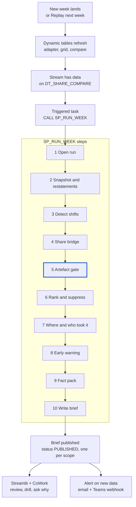
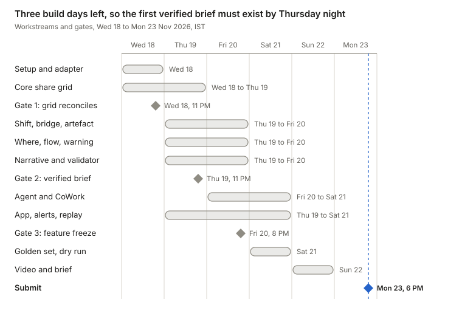

# Share Radar: plan and high-level design (HLD)

This file holds the plan and the high-level design. The low-level design (DDL, procedures, agent spec, app) is in [docs/LLD.md](LLD.md). Tests, AGENTS.md, skills and ticket prompts are in [docs/TESTS_AND_COCO.md](TESTS_AND_COCO.md), and every ticket with its prompt is in [docs/TICKETS.md](TICKETS.md).

## What we are building and why it wins

Share Radar turns every new NIQ data week into a ranked, explained and verified share brief within minutes, entirely inside Snowflake, and CoCo builds every part of it. It covers the four expected outcomes (automated share reports, anomaly detection, narrative briefs, days-to-minutes). It adds three things a generic entry won't have: an exact share bridge, a real-or-artefact gate, and numbers the LLM cannot get wrong.

The feature set follows five verbs: **Detect, Explain, Verify, Anticipate, Act**.

| Verb       | Feature               | What judges see                                                                             | Snowflake feature                                                    | Scope                        |
|------------|-----------------------|---------------------------------------------------------------------------------------------|----------------------------------------------------------------------|------------------------------|
| Detect     | Wake on data          | A week lands (or "Replay next week" is pressed) and a brief appears in minutes              | Dynamic tables, stream, triggered task                               | MVP                          |
| Detect     | Shift detector        | Only material, unexpected shifts surface                                                    | SQL gates + ML ANOMALY_DETECTION                                     | MVP                          |
| Explain    | Share bridge          | Share change split exactly into distribution, velocity, price and promo, with zero residual | SQL (LMDI identity)                                                  | MVP                          |
| Explain    | Where it happened     | Retailer contribution waterfall plus top segments                                           | SQL + ML TOP_INSIGHTS                                                | MVP                          |
| Explain    | Who took it           | Lost share points allocated to the brands that gained                                       | SQL                                                                  | MVP                          |
| Verify     | Real-or-artefact gate | Each shift labelled *market move*, *mixed* or *possible data effect*, with evidence         | SQL rules + HASH_AGG snapshots (data metric functions in production) | MVP                          |
| Verify     | Numbers-locked brief  | The LLM writes words; every number is a placeholder filled from SQL and checked             | AI_COMPLETE structured output + Python validator                     | MVP                          |
| Verify     | Trust panel           | Golden-set accuracy, reconciliation, cost per brief, CoCo build log                         | Streamlit in Snowflake                                               | MVP                          |
| Anticipate | Early warning         | Latest-week distribution or price moves that L4W share hasn't absorbed yet                  | SQL projection; ANOMALY_DETECTION on lever series                    | MVP (SQL), stretch (ML)      |
| Act        | What-if lever         | "Restore distribution to year-ago level: +x pts", clearly labelled mechanical               | Procedure tool                                                       | MVP                          |
| Act        | Ask-Why agent         | Follow-up questions in CoWork answered from the same numbers as the brief                   | Cortex Agent: Analyst + Search + 5 procedure tools                   | MVP                          |
| Act        | Push delivery         | The brief arrives by email or Teams when it is published                                    | Alert on new data + notification integrations                        | MVP (email), stretch (Teams) |
| Build      | CoCo-built            | Every ticket planned, generated, tested and logged by CoCo                                  | CoCo CLI or Snowsight, AGENTS.md, skills, subagent, hooks            | MVP                          |
| Build      | One skill, two agents | The methodology skill CoCo builds with is attached to the CoWork agent                      | Cortex Agent skills from a stage                                     | Stretch                      |

**Against the rubric**

- **Technical (40%):** more than ten native features, each doing real work in deployed objects rather than a notebook.

- **Business relevance (35%):** it answers "why did share move?" and "is it real?", the two questions that cost client-service time, and sits as the proactive layer under Optiq rather than a copy of it.

- **Completeness (25%):** one category end to end on real data, a live replay, measured golden-set accuracy, and a 1–2 page brief.

**Four moments for the video that no generic entry will have**

1.  **Time machine:** press Replay, a past week "lands", and the whole chain runs live on real data.

2.  **Exact bridge:** the waterfall adds up to the reported share change at the second decimal, with no "other" bar.

3.  **Artefact catch:** a shift caused by a retailer feed change is held back, with the evidence shown.

4.  **Unbreakable numbers:** we try to make the LLM write a number and the validator blocks it.

## HLD: architecture

Six layers run inside the NIQ Snowflake account, and only the adapter layer knows NIQ's table names. Everything above Anticipate and Narrate is deterministic SQL or Snowflake ML; the LLM only writes words around numbers it is handed.

```mermaid
flowchart TB
  subgraph SRC["1 SOURCES - NIQ data in the sprint account"]
    A1["RMS weekly facts<br/>sales, units, ACV"]
    A2["Hierarchies<br/>product, market"]
    A3["Store universe<br/>stores per market"]
    A4["Method docs<br/>definitions, rules"]
  end
  subgraph ADP["2 ADAPTER - SRC views"]
    B1["Fact adapter<br/>only file naming NIQ"]
    B2["Dim adapters<br/>product and market"]
    B3["Capability check<br/>bridge mode A to D"]
    B4["Replay control<br/>AS_OF week setting"]
  end
  subgraph CORE["3 CORE - dynamic tables"]
    C1["Period calendar<br/>L4W, P4W, YA, L52W"]
    C2["Brand-week facts<br/>TDP, base, units"]
    C3["Category totals<br/>per market-week"]
    C4["Share compare<br/>now vs before"]
  end
  subgraph INT["4 INTELLIGENCE - SQL + Snowflake ML"]
    D1["Shift detector<br/>gates + anomaly ML"]
    D2["Share bridge<br/>exact, no residual"]
    D3["Artefact gate<br/>real or data effect?"]
    D4["Where, who took it<br/>TOP_INSIGHTS + flow"]
  end
  subgraph NAR["5 ANTICIPATE AND NARRATE - Cortex AI"]
    E1["Early warning<br/>lever drops ahead"]
    E2["Fact pack<br/>every number has ID"]
    E3["AI_COMPLETE<br/>JSON schema, words"]
    E4["Validator<br/>fails closed"]
  end
  subgraph DEL["6 DELIVER - Streamlit, CoWork, alerts"]
    F1["Streamlit review<br/>waterfall, what-if"]
    F2["Agent on CoWork<br/>Analyst + 5 tools"]
    F3["Alerts<br/>email + Teams"]
    F4["Trust panel<br/>golden set, cost"]
  end
  SRC --> ADP --> CORE --> INT --> NAR --> DEL
  style D3 stroke:#2563c9,stroke-width:3px
```

Cross-cutting bands:

- **Orchestration:** stream on share compare → triggered task → `SP_RUN_WEEK` · run log · query tags
- **Governance:** roles · row access by entitlement · approved models only · audit log
- **Built with CoCo:** AGENTS.md · project skills · reviewer subagent · session log hook

The highlighted box (artefact gate) is the piece only this design has. Picture: [img/architecture.svg](img/architecture.svg)

*Share Radar architecture · 6 layers, 3 cross-cutting bands*

Each layer maps to a schema (SRC, CORE, APP and ML, SEM, OPS, KB), and each box maps to a ticket in the ticket list and an object in docs/LLD.md.

## HLD: what happens when a data week lands

A new week (or a replayed one) refreshes the dynamic tables; the stream on the share table fires a triggered task, and `SP_RUN_WEEK` runs ten steps. Every number is fixed before the LLM is called.

| Step | What it does | Writes |
| --- | --- | --- |
| 1 Open run | run_id, idempotency, query tag | `OPS.RUN_LOG` |
| 2 Snapshot and restatements | HASH_AGG per week × market | `OPS.FACT_SNAPSHOT` |
| 3 Detect shifts | gates + ANOMALY_DETECTION | `APP.SHIFT_CANDIDATE` |
| 4 Share bridge | exact LMDI, modes A to D | `APP.SHARE_BRIDGE` |
| 5 Artefact gate | rules R1 to R6, evidence kept | `APP.ARTEFACT_CHECK` (data effects held back) |
| 6 Rank and suppress | value at stake × confidence | `APP.SHIFT_RANKED` |
| 7 Where and who took it | retailer split + TOP_INSIGHTS | `APP.SHIFT_WHERE`, `APP.SHARE_FLOW` |
| 8 Early warning | lever drops not yet in L4W share | `APP.EARLY_WARNING` |
| 9 Fact pack | every number gets an ID and source | `APP.FACT_PACK` |
| 10 Write brief | AI_COMPLETE JSON, then validator | `APP.BRIEF` (template if checks fail twice) |

Picture: [img/weekly_run.svg](img/weekly_run.svg)

*Weekly run · 4 trigger steps, 10 run steps, 3 delivery points*

Steps 2 to 9 are set-based SQL or Snowflake ML and are retried independently. A failure in steps 3 (ML part), 7 (TOP_INSIGHTS) or 8 downgrades the brief instead of stopping it; the error matrix in docs/LLD.md lists each case.

## HLD: the Ask-Why agent on CoWork

One Cortex Agent, `SR_DB.SEM.SHARE_RADAR_AGENT`, answers follow-up questions in CoWork from the same tables the brief was written from, so chat and brief can never disagree. It never computes a number: every figure comes from a tool result.

| Tool name          | Type                       | Resource                                             | Input                                        | Returns                                                                                | Used when                                                               |
|--------------------|----------------------------|------------------------------------------------------|----------------------------------------------|----------------------------------------------------------------------------------------|-------------------------------------------------------------------------|
| `share_analyst`    | cortex_analyst_text_to_sql | Semantic view `SR_DB.SEM.SV_SHARE`                   | Natural-language question                    | SQL result                                                                             | Any share, sales or distribution number not covered by another tool     |
| `method_search`    | cortex_search              | Service `SR_DB.SEM.CSS_METHOD` over `KB.METHOD_DOCS` | Query text                                   | Up to 4 passages                                                                       | "What does ACV / TDP / velocity mean?", "How is the bridge calculated?" |
| `get_share_bridge` | generic (procedure)        | `SR_DB.APP.TOOL_GET_SHARE_BRIDGE`                    | `p_brand`, `p_market`, `p_cmp_code`          | JSON: share now and before, change, bridge terms in points, top retailer contributions | Every "why did share move?" question                                    |
| `check_artefact`   | generic (procedure)        | `SR_DB.APP.TOOL_CHECK_ARTEFACT`                      | `p_market`, `p_cmp_code`, `p_brand`          | JSON: label and rule hits with evidence                                                | Every "why" answer, and "is this real?"                                 |
| `share_flow`       | generic (procedure)        | `SR_DB.APP.TOOL_SHARE_FLOW`                          | `p_brand`, `p_market`, `p_cmp_code`          | JSON: brands that gained the lost points, with points                                  | "Who took it?", "Where did the share go?"                               |
| `what_if`          | generic (procedure)        | `SR_DB.APP.TOOL_WHAT_IF`                             | `p_brand`, `p_market`, `p_lever`, `p_target` | JSON: mechanical share impact and its assumption                                       | "What if we restored distribution or promo to year-ago levels?"         |
| `latest_brief`     | generic (procedure)        | `SR_DB.APP.TOOL_LATEST_BRIEF`                        | `p_scope` (optional)                         | JSON: headline and top shifts of the latest published brief                            | "What changed this week?"                                               |

**Routing rules (in the agent's orchestration instructions)**

1.  A "why" question calls `get_share_bridge`, then `check_artefact`, before any answer is written.

2.  If `check_artefact` returns `POSSIBLE_DATA_EFFECT`, the first sentence says so.

3.  "Who took it" calls `share_flow`; lever scenarios call `what_if`, and the answer repeats its assumption.

4.  Any other number goes through `share_analyst`; definitions go through `method_search`.

5.  Numbers are quoted exactly as returned, with the period comparison named (for example L4W vs year ago).

6.  A tool error or empty result is reported as such, never filled in.

The agent is added to the CoWork object so analysts find it next to their other agents. The full YAML specification is in docs/LLD.md.

## Design decisions and assumptions

Every decision below trades a little elegance for something we can finish, test and defend in front of NIQ judges by 23 Nov.

| ID  | Decision                        | Options considered                                       | Choice                                                                                 | Why                                                                           |
|-----|---------------------------------|----------------------------------------------------------|----------------------------------------------------------------------------------------|-------------------------------------------------------------------------------|
| D1  | How we read NIQ data            | Query NIQ tables directly; canonical adapter views       | Adapter views in `SRC`; one file names NIQ tables                                      | The schema was unknown at design time; a mapping change touches one file      |
| D2  | Distribution and velocity basis | Max ACV of items; TDP (sum of item %ACV)                 | TDP, with velocity = sales per TDP point                                               | TDP adds up across items and markets; max ACV does not                        |
| D3  | Share decomposition             | Mix-only waterfall; regression; relative LMDI identity   | Relative LMDI: share = distribution share × velocity index × price index × promo index | Exact (no residual), handles zero change, every term is a business lever      |
| D4  | Shift detection                 | ML only; rules only; rules gated, ML to confirm          | Rule gates (points, value, z-score) plus ANOMALY_DETECTION as confirmation             | Explainable to analysts; ML adds the "unexpected vs seasonal" signal          |
| D5  | What Cortex Analyst queries     | Raw weekly facts; precomputed share tables               | Precomputed share grid and share-change views                                          | Share-of-total SQL is easy to get wrong; the agent and the brief must match   |
| D6  | Who writes numbers              | LLM writes the text; LLM writes text with placeholders   | Placeholders `{{fNN}}`, validator, template fallback                                   | One wrong number in front of judges ends the demo                             |
| D7  | Trigger                         | Fixed schedule; stream-triggered task; alert on new data | Stream on the share table + triggered task to compute; alert on new data to deliver    | Event-driven end to end, and it shows two native features doing distinct jobs |
| D8  | Demo "new week"                 | Wait for real data; synthetic week; replay control       | Replay: an `AS_OF_WEEK_END` setting the adapter filters on                             | Real data, live trigger, and repeatable on stage                              |
| D9  | Procedure language              | All Python; all SQL; SQL first                           | SQL (Snowflake Scripting) for set logic, Python for orchestration, LLM and validator   | CoCo writes strong SQL, and SQL avoids package overhead                       |
| D10 | Grain for the MVP               | SKU; brand                                               | Brand × market × period; SKU only for the recode rule                                  | Fits five build days; matches how reviews are read                            |
| D11 | LLM model                       | Hard-coded; setting                                      | `OPS.SETTINGS` key `LLM_MODEL` with a fallback model                                   | NIQ approvals and region availability may change the model                    |

**Assumptions to confirm today (and what we do if wrong)**

1.  **A1** Weekly facts with at least 104 weeks of history. *If fewer:* drop year-ago comparisons and use L4W vs prior period only.

2.  **A2** Item-level %ACV distribution exists. *If not:* bridge mode C or D (velocity or mix only); the artefact gate leans on store counts.

3.  **A3** Base (non-promoted) sales exist. *If not:* bridge mode B (distribution, unit velocity, average price) with no separate promo term.

4.  **A4** Retailer markets roll up to a parent market. *If not:* TOP_INSIGHTS replaces the exact retailer split.

5.  **A5** Cortex Agents, CoWork, AI_COMPLETE and ML functions are enabled for the team role. *If not:* Streamlit becomes the only surface and an AI_COMPLETE call answers questions.

6.  **A6** We may create notification integrations, or organizers can. *If not:* the brief stays in-app, plus an emailed export done by hand for the video.

7.  **A7** A team database and warehouse exist. *If not:* the setup DDL in docs/LLD.md creates them.

8.  **A8** One focus manufacturer (the "client") and one category are chosen for the demo; others still compute.

## CoCo-first engineering

CoCo writes the code; people write the contract (docs/LLD.md), approve CoCo's plans and review its diffs. Every ticket leaves evidence a judge can check, because 40% of the score rests on CoCo-generated code.

**Where CoCo runs.** Use the [CoCo CLI](https://docs.snowflake.com/en/user-guide/cortex-code/cortex-code?lang=it) if NIQ allows the install: it loads `AGENTS.md` and [project skills, subagents and hooks](https://docs.snowflake.com/fr/user-guide/cortex-code/extensibility) from the repo. Otherwise use [CoCo in Snowsight](https://docs.snowflake.com/user-guide/cortex-code/cortex-code-snowsight) inside a Git-connected Workspace. There, [personal skills](https://docs.snowflake.com/user-guide/cortex-code/cortex-code-snowsight/skills-and-plugins) live in the workspace's `.snowflake/cortex/skills` folder, and every edit is shown as a diff before it is applied.

| CoCo asset                 | Path                                            | What it does                                                                                                          |
|----------------------------|-------------------------------------------------|-----------------------------------------------------------------------------------------------------------------------|
| `AGENTS.md`                | repo root                                       | Project rules: layers, naming, "numbers from SQL only", test-first, definition of done                                |
| `sr-sql-conventions` skill | `.cortex/skills/sr-sql-conventions/SKILL.md`    | File header, idempotent DDL, query tags, step logging                                                                 |
| `share-methodology` skill  | `.cortex/skills/share-methodology/SKILL.md`     | Bridge identity, modes A–D, edge cases, artefact rules. The same file is later attached to the CoWork agent (stretch) |
| `sr-cortex-agent` skill    | `.cortex/skills/sr-cortex-agent/SKILL.md`       | Agent spec patterns, required `execution_environment`, tool procedures                                                |
| `sr-streamlit` skill       | `.cortex/skills/sr-streamlit/SKILL.md`          | Streamlit in Snowflake patterns: session, caching, Altair charts                                                      |
| `sr-tests` skill           | `.cortex/skills/sr-tests/SKILL.md`              | Named-test format (a query returns zero rows when passing) and the runner                                             |
| `sr-reviewer` subagent     | `.cortex/agents/sr-reviewer.md`                 | Reviews each diff against AGENTS.md and the LLD, then runs the ticket's tests                                         |
| Stop hook                  | `.cortex/settings.json` → `scripts/coco_log.py` | After each session, appends ticket, files touched and tests to `docs/coco_log.md`                                     |
| Ticket prompts             | docs/TESTS_AND_COCO.md                                | One ready-to-paste prompt per ticket                                                                                  |

**The loop for every ticket**

1.  Set the ticket: `echo SR-022 > .sr_ticket`.

2.  Run `/plan` with the ticket prompt. CoCo reads AGENTS.md, the skills and the LLD section; a person approves the plan.

3.  CoCo writes only the files the ticket names.

4.  CoCo runs the ticket's named tests (`snow sql -f tests/sql/T-BR-01.sql`, `pytest -q`) and fixes until they pass.

5.  The `sr-reviewer` subagent checks the diff; a person reviews it in the diff view.

6.  Commit as `SR-022: 
` with the trailer `Generated-with: CoCo`; the Stop hook logs the session.

**Keep people on** methodology choices, thresholds, golden-set answers and the story. **Give CoCo** schema discovery (SR-003), DDL, set-based SQL, tests, the Streamlit pages and the agent spec.

**How we prove it to judges** (Trust page, solution brief and one video clip)

- Tickets delivered through CoCo, as a count and a share of all tickets.

- Share of committed lines carrying the `Generated-with: CoCo` trailer, from `git log`.

- Tests written and passing per ticket.

- Median minutes per ticket, from the session log.

- A 30-second clip: CoCo turns the SR-022 prompt into the bridge procedure and its tests go green.

CoCo usage draws on AI credits, so ask the organizers whether it counts against the team budget (see Risks).

## Build plan timeline

With the build window already at day 3, the plan runs three build days, one hardening day and one day for the video, behind four gates. Work that misses its gate moves to the cut line rather than pushing the gate.

The dates in this picture are the original sprint plan. Use docs/TICKETS.md for the build order.

*Build timeline · 9 workstreams, 3 gates, submission*

If the team already has parts working, mark those tickets Done in the ticket list and pull the next gate forward.

## Ticket list

37 MVP tickets (71 hours) fit four people working from Wednesday afternoon to Saturday; four stretch tickets add 4.5 hours. Roles, not names: **DE** data engineer, **AI** ML/AI engineer, **APP** app engineer, **PM** product, domain and story. With three people, APP merges into AI. Update the Status column as you go; test IDs are defined in docs/TESTS_AND_COCO.md.

**Setup, core and intelligence**

| ID     | Ticket                                                                       | Stream       | Role    | Est (h) | Depends on             | Done when                                                      | Scope   | Status      |
|--------|------------------------------------------------------------------------------|--------------|---------|---------|------------------------|----------------------------------------------------------------|---------|-------------|
| SR-001 | Repo, AGENTS.md, CoCo skills, reviewer subagent, Stop hook                   | Setup        | PM      | 1.5     | —                      | CoCo lists the 5 skills; a test session writes a coco_log line | MVP     | Done |
| SR-002 | Roles, warehouses, schemas, OPS.SETTINGS, run and step logs                  | Setup        | DE      | 1       | SR-001                 | Setup scripts rerun cleanly; settings seeded                   | MVP     | Code done; run on account |
| SR-003 | Source discovery (CoCo explores NIQ tables), adapter views, capability check | Setup        | DE      | 3       | SR-002                 | T-SRC-01..03 pass; OPS.CAPABILITY written                      | MVP     | Code done; mapping needs approval |
| SR-004 | Pick demo scope: country, category, focus manufacturer, parent market        | Setup        | PM      | 0.5     | SR-003                 | Settings updated and agreed                                    | MVP     | Needs decision (queries ready) |
| SR-010 | Period calendar dynamic table                                                | Core         | DE      | 1.5     | SR-003                 | T-CORE-04 passes                                               | MVP     | Code done; run on account |
| SR-011 | Brand-week and category-week dynamic tables                                  | Core         | DE      | 1.5     | SR-003                 | T-CORE-02 passes                                               | MVP     | Code done; run on account |
| SR-012 | Brand-period, category-period and share-compare dynamic tables, grid views   | Core         | DE      | 2.5     | SR-010, SR-011         | T-CORE-01 passes                                               | MVP     | Code done; run on account |
| SR-013 | Reconcile five numbers to an NIQ reference                                   | Core         | PM      | 1       | SR-012                 | T-CORE-03 passes; any gap explained                            | MVP     | Code done; needs 5 reference numbers |
| SR-020 | Shift detector: gates and z-score into SHIFT_CANDIDATE                       | Intelligence | DE      | 2       | SR-012                 | T-DET-01..02 pass                                              | MVP     | Code done; run on account |
| SR-021 | ANOMALY_DETECTION on weekly share series                                     | Intelligence | AI      | 2       | SR-011                 | T-ML-01 passes; training under 10 min                          | MVP     | Code done; run on account |
| SR-022 | Share bridge procedure (LMDI, modes A–D) and Python mirror                   | Intelligence | DE + AI | 3       | SR-012                 | T-BR-01..05 pass                                               | MVP     | Code done; run on account |
| SR-023 | Where: exact retailer split and TOP_INSIGHTS for ranked shifts               | Intelligence | AI      | 2.5     | SR-012, SR-026         | T-WH-01..02 pass                                               | MVP     | Code done; run on account |
| SR-024 | Artefact gate rules R1–R6 and snapshot hashes                                | Intelligence | DE      | 3       | SR-011                 | T-ART-01..05 pass                                              | MVP     | Code done; run on account |
| SR-025 | Share flow (who took it)                                                     | Intelligence | AI      | 1.5     | SR-012                 | T-FLOW-01..02 pass                                             | MVP     | Code done; run on account |
| SR-026 | Materiality score, ranking and suppression into SHIFT_RANKED                 | Intelligence | DE      | 1.5     | SR-020, SR-022, SR-024 | T-RANK-01..02 pass                                             | MVP     | Code done; run on account |
| SR-027 | Early warning: mechanical SQL projection                                     | Intelligence | AI      | 1.5     | SR-011                 | T-EW-01 passes                                                 | MVP     | Code done; run on account |
| SR-028 | Early warning: ANOMALY_DETECTION on lever series                             | Intelligence | AI      | 1.5     | SR-021, SR-027         | T-EW-02 passes                                                 | Stretch | Code done; run on account |
| SR-029 | What-if procedure                                                            | Intelligence | AI      | 1       | SR-022                 | T-WI-01 passes                                                 | MVP     | Code done; run on account |

**Narrative, agent, delivery and ship**

| ID     | Ticket                                                              | Stream    | Role | Est (h) | Depends on                             | Done when                                         | Scope   | Status      |
|--------|---------------------------------------------------------------------|-----------|------|---------|----------------------------------------|---------------------------------------------------|---------|-------------|
| SR-030 | Fact pack builder                                                   | Narrative | AI   | 2       | SR-023, SR-025, SR-026, SR-027         | T-FP-01 passes                                    | MVP     | Code done; run on account |
| SR-031 | Brief writer: prompt and AI_COMPLETE structured output              | Narrative | AI   | 2       | SR-030                                 | Valid JSON on three runs in a row                 | MVP     | Code done; run on account |
| SR-032 | Validator, renderer and template fallback                           | Narrative | AI   | 3       | SR-031                                 | T-NAR-01..05 pass                                 | MVP     | Code done; run on account |
| SR-033 | Orchestrator SP_RUN_WEEK, logs, query tags                          | Narrative | DE   | 2       | SR-020 to SR-032                       | T-E2E-01, T-E2E-02 and T-E2E-04 pass              | MVP     | Code done; run on account |
| SR-040 | Semantic view over grid and change views                            | Agent     | AI   | 2       | SR-012, SR-022, SR-024                 | 10 golden questions right through Analyst         | MVP     | Code done; run on account |
| SR-041 | Method docs (KB) and Cortex Search service                          | Agent     | PM   | 2       | SR-002                                 | Right passage for 5 definition queries            | MVP     | Code done; run on account |
| SR-042 | Tool procedures: bridge, artefact, flow, what-if, latest brief      | Agent     | DE   | 2       | SR-022, SR-024, SR-025, SR-029, SR-032 | T-TOOL-01..05 pass                                | MVP     | Code done; run on account |
| SR-043 | Agent specification and CoWork registration                         | Agent     | AI   | 1.5     | SR-040, SR-041, SR-042                 | Three sample questions answered in CoWork         | MVP     | Code done; run on account |
| SR-044 | Golden set (30 questions) and evaluation run                        | Agent     | PM   | 2.5     | SR-043                                 | At least 27 of 30 correct; OPS.EVAL_RESULT filled | MVP     | Code done; questions need review on real names |
| SR-045 | Methodology skill attached to the agent                             | Agent     | AI   | 1       | SR-043                                 | Agent explains the method when asked "how"        | Stretch | Steps written (stretch) |
| SR-050 | Streamlit: Radar home and replay button                             | Delivery  | APP  | 3       | SR-026, SR-033                         | Replay shows a new brief without errors           | MVP     | Code done; run on account |
| SR-051 | Streamlit: shift detail (waterfall, where, flow, artefact, what-if) | Delivery  | APP  | 3       | SR-022 to SR-029                       | T-UI-01 passes                                    | MVP     | Code done; run on account |
| SR-052 | Streamlit: brief page with provenance, Trust page                   | Delivery  | APP  | 2.5     | SR-032, SR-044                         | Every number shows its source                     | MVP     | Code done; run on account |
| SR-053 | Stream, triggered task and replay procedure                         | Delivery  | DE   | 1.5     | SR-033                                 | Replay starts a run within 2 minutes              | MVP     | Code done; run on account |
| SR-054 | Email notification and alert on new brief                           | Delivery  | APP  | 1.5     | SR-032                                 | Email received for a published brief              | MVP     | Code done; run on account |
| SR-055 | Teams webhook notification                                          | Delivery  | APP  | 1       | SR-054                                 | Teams message received                            | Stretch | Code done (stretch); secret by organizers |
| SR-056 | Roles, grants, row access policy, judge role                        | Delivery  | DE   | 1       | SR-012                                 | T-SEC-01..03 pass                                 | MVP     | Code done; run on account |
| SR-057 | Data metric functions on the fact adapter                           | Delivery  | DE   | 1       | SR-003                                 | DMF results visible                               | Stretch | Code done; run on account |
| SR-060 | Time the manual share review with 2–3 analysts                      | Ship      | PM   | 1       | —                                      | Minutes per review recorded                       | MVP     | Not started (people) |
| SR-061 | End-to-end timing and dry run                                       | Ship      | PM   | 1       | All MVP tickets                        | Replay to email within target                     | MVP     | Local dry run passes; account dry run pending |
| SR-062 | Demo video, 5 minutes max                                           | Ship      | PM   | 4       | SR-061                                 | Video under 5:00 uploaded                         | MVP     | Not started (people) |
| SR-063 | Solution brief, 1–2 pages                                           | Ship      | PM   | 2       | SR-061                                 | Reviewed by the team                              | MVP     | Draft written |
| SR-064 | Code freeze, README, submission                                     | Ship      | All  | 1       | SR-062, SR-063                         | Submitted before 23 Nov, 11:59 PM IST             | MVP     | README done; submission pending |

## Demo script and submission checklist

The video follows one shift from "a week lands" to "the analyst knows what to do", in 5 minutes, on real data. Words in angle brackets are filled from measured results, never estimated.

| Time      | On screen                                                                                                          | Say (one line)                                                                                       | Proves                                                  |
|-----------|--------------------------------------------------------------------------------------------------------------------|------------------------------------------------------------------------------------------------------|---------------------------------------------------------|
| 0:00–0:30 | Title, then the manual process                                                                                     | "A competitive share review takes \<measured hours\> today, timed with \<n\> analysts."              | Business relevance, measured baseline                   |
| 0:30–1:00 | Radar home: press **Replay next week**; run log ticks; brief appears with a stopwatch overlay                      | "A new week landed. \<minutes\> later, the brief is ready."                                          | Days to minutes; dynamic tables, stream, triggered task |
| 1:00–1:50 | Top shift, then detail: bridge waterfall, retailer split, who took it                                              | "Distribution explains most of it, mostly in one retailer, and two brands took the points."          | Exact bridge, TOP_INSIGHTS, share flow                  |
| 1:50–2:30 | A held-back shift with its artefact evidence                                                                       | "This 'loss' is a retailer feed change, so we didn't alert the client."                              | Real-or-artefact gate, Input Validation knowledge       |
| 2:30–3:10 | Brief page with the provenance toggle; validator log rejecting a planted number                                    | "Every number links to its query, and the LLM can't write its own."                                  | Numbers-locked narrative                                |
| 3:10–3:50 | CoWork: "Why did \<brand\> lose share in \<market\>?", then "Who took it?", then "What if distribution came back?" | "Follow-ups use the same numbers as the brief."                                                      | Cortex Agent with Analyst, Search and tools             |
| 3:50–4:20 | Email or Teams message arrives; early-warning watchlist                                                            | "It also flags what will hit share next month."                                                      | Push delivery, anticipation                             |
| 4:20–4:45 | Trust page (golden-set score, reconciliation, credits per brief, CoCo log) and a 10-second CoCo clip               | "\<x\> of \<y\> tickets were built by CoCo, and every one has tests."                                | Technical execution, CoCo quality                       |
| 4:45–5:00 | Close                                                                                                              | "Client service gets the brief on Monday morning; next comes more categories and a feed into Optiq." | Path to production                                      |

**Solution brief (1–2 pages):** problem and measured baseline; what Share Radar does (the five verbs); architecture diagram; results (minutes per brief, golden-set accuracy, credits per brief); how CoCo built it; path to production; limits.

**Submission checklist**

- [ ] App deployed on NIQ's Snowflake: Streamlit link, agent visible in CoWork, judge role granted
- [ ] Demo video under 5:00, captioned, uploaded where the organizers say
- [ ] Solution brief, 1–2 pages, with only measured numbers
- [ ] README: deploy order, object list, how to replay a week
- [ ] `docs/coco_log.md` and Git history with `Generated-with: CoCo` trailers
- [ ] Golden-set and reconciliation results stored in OPS tables
- [ ] Client and brand names masked if the organizers require it
- [ ] Credits used, summarised
- [ ] Submitted by 23 Nov, 11:59 PM IST (team target: 6 PM)

## Risks, fallbacks and the cut line

The two risks that can sink the build are missing measures in the Track 4 data and features switched off on the sprint account; both are checked on Wednesday, before the core work starts.

| Risk                                                                                             | Severity | Fallback                                                                                                   |
|--------------------------------------------------------------------------------------------------|----------|------------------------------------------------------------------------------------------------------------|
| Track 4 data lacks ACV distribution, base sales or units                                         | High     | The capability check (SR-003) picks bridge mode B, C or D automatically; TOP_INSIGHTS still explains where |
| A needed feature is off: CoWork, Agents, ML functions, the chosen LLM, notification integrations | High     | Run the feature smoke test in LLD §L1 on Wednesday; fallbacks per assumptions A5 and A6                    |
| The LLM misstates a number in a live demo                                                        | High     | Placeholders, validator, template fallback; the agent quotes tools only                                    |
| Three build days left                                                                            | High     | Gates below, the cut line, feature freeze on Friday at 8 PM                                                |
| ANOMALY_DETECTION or TOP_INSIGHTS is slow or costly across many series                           | Medium   | Run them on the focus scope and ranked shifts only; skip failing series                                    |
| The agent picks the wrong tool, or Analyst writes wrong share SQL                                | Medium   | Precomputed views, semantic-view SQL rules, routing instructions, golden set                               |
| Email or webhook integrations need admin privileges                                              | Medium   | Ask the organizers on Wednesday; otherwise show in-app delivery                                            |
| Client confidentiality in the video                                                              | Medium   | A display-alias setting masks manufacturer and brand names                                                 |
| CoCo usage draws on the team's credit budget                                                     | Medium   | Ask the organizers; keep CoCo sessions ticket-sized; log usage                                             |
| Judges ask whether the replay is real                                                            | Low      | Say it plainly: real NIQ weeks replayed in order, with the as-of week shown on screen                      |

**Gates (IST)**

1.  **Wed 18 Nov, 11 PM:** the share grid reconciles to an NIQ reference (SR-013).

2.  **Thu 19 Nov, 11 PM:** the first verified brief is produced end to end (SR-033).

3.  **Fri 20 Nov, 8 PM:** feature freeze; only fixes after this.

4.  **Sat 21 Nov, 8 PM:** golden set at 27 of 30 or better, and a full dry run.

5.  **Sun 22 Nov:** video and solution brief. **Mon 23 Nov, 6 PM:** submit.

**Cut line if we are behind at Friday noon** (cut in this order)

1.  Stretch tickets: SR-028, SR-045, SR-055, SR-057.

2.  TOP_INSIGHTS drops; the exact retailer split stays.

3.  What-if keeps the distribution lever only.

4.  Early warning hides if it isn't robust.

**Never cut:** the bridge, the artefact gate, the validator, replay, the golden set, and the agent's bridge and artefact tools.
