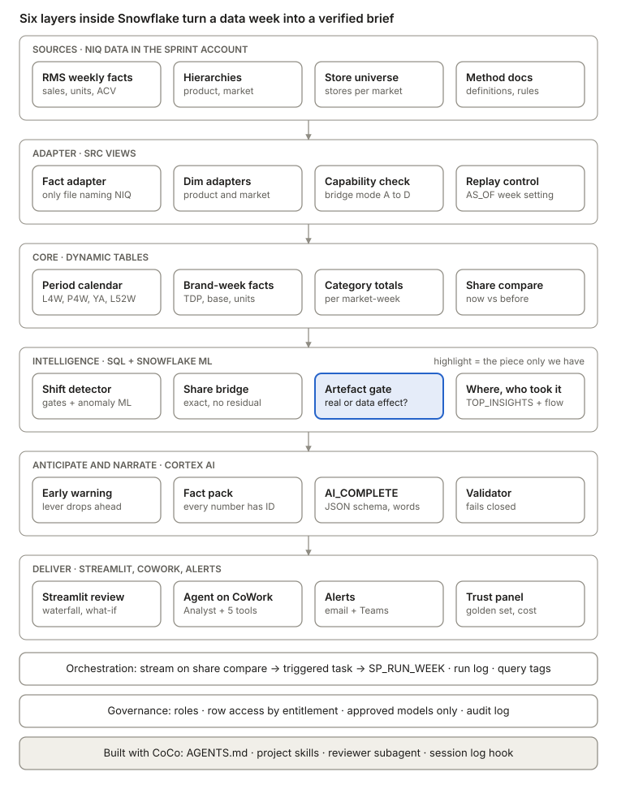

# Share Radar: solution brief (draft for the team to edit)

> Draft from docs/HLD.md, docs/LLD.md and docs/decisions.md. Every `<measured>` value comes from the Trust page
> (OPS.EVAL_RESULT, OPS.V_RUN_COST, OPS.COCO_LOG) after the dry run. Do not replace one with an estimate.

## The problem

When NIQ data lands each week, client-service analysts answer the same two questions by hand for every client:
*why did share move?* and *is it real?* A competitive share review takes `<measured hours>` today (timed with
`<n>` analysts, SR-060). The answer usually comes days after the data, and a data effect (a retailer feed change, a
restatement) sometimes reaches the client as a "market move".

## What Share Radar does

Share Radar turns every new NIQ week into a ranked, explained and verified share brief in minutes, entirely inside
Snowflake. It follows five verbs.

- **Detect.** A new week (or a replayed one) refreshes the dynamic tables; a stream wakes a triggered task, and
  `SP_RUN_WEEK` finds the shifts that pass three gates (share points, value at stake, z-score against the brand's own
  history), with Snowflake ANOMALY_DETECTION as confirmation.
- **Explain.** An exact LMDI bridge splits each share change into distribution, velocity, price and promo, in share
  points, with zero residual and no "other" bar. An exact performance/mix split shows which retailer it happened in,
  TOP_INSIGHTS ranks the segments behind it, and a proportional flow shows which brands took the points.
- **Verify.** Six artefact rules (coverage, feed, restatement, recode, spike, gap) label each shift *market move*,
  *mixed* or *possible data effect*; data effects are held back from the brief, with evidence. The LLM never writes
  a number: it writes `{{f12}}` placeholders, a validator rejects any bare digit, and a template brief takes over if
  two attempts fail, so a brief is always published and every number links to the query it came from.
- **Anticipate.** A latest-week distribution or price move that the four-week share has not absorbed yet goes on a
  watchlist, with its mechanical effect on next month's share.
- **Act.** The brief arrives by email; a Cortex Agent in CoWork answers follow-ups (why, who took it, is it real, what
  if) from the same tables, so chat and brief never disagree.

## Results

| Measure | Result | Source |
| --- | --- | --- |
| Time from a new week to a published brief | `<measured minutes>` | SR-061 dry run |
| Manual review it replaces | `<measured hours>` per review | SR-060 |
| Golden set (30 analyst questions, right tool and right number) | `<measured>/30` (bar 27) | OPS.EVAL_RESULT |
| Reconciliation to NIQ reference numbers | `<measured>/5` within 0.05 pts / 0.5% | OPS.RECON_RESULT |
| Largest bridge residual | `<measured>` pts (bar 1e-6) | T-BR-01 |
| Credits per weekly run | `<measured>` | OPS.V_RUN_COST |
| LLM tokens per brief | `<measured>` | APP.BRIEF |

Verified before the account was available (repository CI, measured): 132 unit and page tests pass; the pipeline SQL,
run on DuckDB against synthetic data with six planted events, executes end to end and passes 16 of the project's own
SQL tests as written; the SQL bridge equals its independent Python mirror on every row within 1e-9 points; every
fact in the generated brief re-reads exactly from its source table. The synthetic run found every planted event and
held back the parent market while a retailer feed was out. That run surfaced two fixes now in the design (decisions
B12, B13).

## How it was built

Every ticket was planned, generated and tested by a coding agent working from the LLD contract, one ticket per
commit (`git log`), with the session log in `docs/coco_log.md`: `<measured>` tickets, `<measured>` lines,
`<measured>` sessions that wrote tests. The design's proof points count CoCo sessions and `Generated-with: CoCo`
commit trailers; the commits so far carry the agent that actually wrote them, so the team should decide how to
present this before submission.

## Path to production

More categories and markets are a settings change: remove the scope filter in `DT_BRAND_WEEK` and add entitlements.
The adapter is one file, so a schema change touches one file. Next: data metric functions on the fact feed (SR-057),
the Teams channel (SR-055), and a feed into Optiq.

## Limits

- The flow of share between brands is an accounting allocation, not evidence of shopper switching; it is labelled so.
- What-if results are mechanical (other levers held), not forecasts; the agent repeats the assumption.
- TOP_INSIGHTS explains brand *sales* change by segment, not share.
- Artefact rules catch known data effects; anything else is reported as a market move with its confidence.
